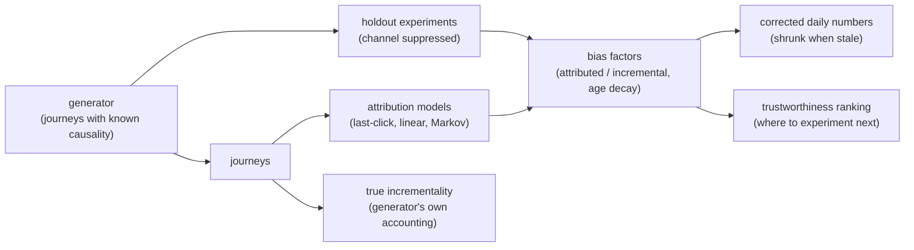

# attributiongap

Markov attribution scored against experimental truth, publishing a per-channel bias factor that corrects the daily numbers.

[](https://github.com/chandravuddamari-spec/attributiongap/actions/workflows/ci.yml)

## Why

The attribution tool says paid search drove 4,200 conversions. The holdout experiment says its incremental contribution was 1,100. Both numbers end up in the same deck, quoted by different teams, and the organisation budgets against the larger one because it is the more comfortable number.

A Markov removal-effect model is a better attribution model than last-click, but it still distributes observed credit among observed touchpoints. That is a different quantity from incrementality. This project builds the model, scores it against experimental ground truth, and publishes a per-channel bias factor that corrects the fast-moving daily numbers between infrequent experiments. Every factor carries the age of the experiment behind it, and old factors are shrunk rather than applied at full strength.

## Features

- Synthetic user journeys with a known causal structure: some channels genuinely incremental, some merely correlated with intent (brand search as a toll booth).
- Three attribution models: last-click, linear, and Markov removal effect (channel removal modelled as an absorbing NULL state).
- Simulated holdout experiments that provide ground truth (treated vs suppressed-channel conversion rates).
- Per-channel bias factors (`attributed / incremental`) with an exponential-decay confidence and a stale flag.
- Bias-corrected daily numbers that shrink toward the raw figure as the experiment ages.
- A trustworthiness ranking that says which channel's next experiment is worth the most.
- Standard library only; nothing to install.

## Architecture



`src/generator.py` simulates users, their touchpoint paths and their conversions, and runs holdout experiments. `src/attribution.py` holds the attribution models and the bias-factor logic. `src/demo.py` runs the whole pipeline and prints the report.

## Quick start

Requires Python 3.11+. There are no dependencies.

```bash
git clone https://github.com/chandravuddamari-spec/attributiongap.git
cd attributiongap
python -m unittest discover -s tests -v   # run the test suite
python -m src.demo                        # run the end-to-end report
```

## Example

`python -m src.demo` simulates 60,000 users and prints, among other sections, the share of credit by model against truth (trimmed):

```
  channel            last-click    linear    markov     TRUTH   markov bias
  brand_search           58.8%     23.3%     21.9%      9.4%         2.34x
  affiliate              26.9%     15.2%     15.5%      9.1%         1.71x
  display                 0.4%     13.2%     13.7%      3.5%         3.89x
  generic_search          2.8%     12.6%     12.5%     25.9%         0.48x
  paid_social             0.8%     10.6%     10.7%     19.3%         0.56x
```

and then the bias factors and corrected numbers:

```
    channel            attributed   incremental   factor    age  confidence
    brand_search            2,455           447    5.49x   400d         5%   STALE
    generic_search          1,394         2,211    0.63x    12d        91%
    display                 1,535           429    3.58x    95d        48%

    channel                   raw   corrected                               why
    brand_search            2,455       2,362      shrunk: evidence is 400d old
    generic_search          1,394       2,139                   full correction
    display                 1,535       1,003       shrunk: evidence is 95d old
```

The whole demo is seeded, including the holdout experiments, so repeated runs print identical output.

## How it works

- **Journey generator.** Each user draws an intent value before any marketing. Late-funnel channels (brand search, affiliate) appear more often for high-intent users, which is the confounding that makes attribution misleading: the channel follows the conversion rather than causing it. `TRUE_INCREMENTALITY` records the real per-channel effect.
- **Markov removal effect.** Transitions are counted over `START -> channels -> CONVERT/NULL`. To remove a channel, it becomes an absorbing NULL state, so any path through it cannot convert. Deleting the channel from each path instead leaves every journey converting as before and yields a removal effect of zero for every channel. Credit is proportional to the drop in conversion probability, computed by value iteration.
- **Bias factor.** `attributed / incremental` per channel, where incremental comes from a holdout experiment. Above 1 means over-credited.
- **Decay.** Confidence is `0.5 ** (age_days / half_life_days)` with a 90-day half-life; below 0.25 the factor is flagged stale. The corrected figure is `confidence * (raw / factor) + (1 - confidence) * raw`, so an old factor fades out instead of being applied silently.
- **Next experiment.** Channels are ranked by `|log(factor)|` weighted by how stale the evidence is.

## Testing

```bash
python -m unittest discover -s tests -v
```

The suite (21 tests, `tests/test_attribution.py`) checks the models and bias-factor logic against synthetic data where the truth is known.

## Project layout

```
src/generator.py     journey simulation, true incrementality, holdout experiments
src/attribution.py   last-click, linear, Markov removal effect, bias factors
src/demo.py          end-to-end report (python -m src.demo)
tests/               unit tests
docs/ARCHITECTURE.md design notes
```

## Limitations

- All data is synthetic; the project consumes journeys and does not collect them.
- It complements experiments rather than replacing them: it bridges infrequent experiments and daily decisions.
- The decay model uses a fixed half-life; a real deployment would fit it to how quickly each channel's bias drifts.
- The holdout is simulated, so factor estimates carry sampling noise that is not modelled as an explicit uncertainty interval.

## License

MIT, see [LICENSE](LICENSE).

## Maintainer

Originally developed in the `chandravuddamari-spec` repository; currently maintained by **Sai Chandra Vuddamari**, Research and Innovation Analyst, with 4+ years of professional experience in analytics and reporting.

For project or maintenance questions, contact [sssaichandra375@gmail.com](mailto:sssaichandra375@gmail.com). **Key skills:** SQL, Python, R, and VBA.