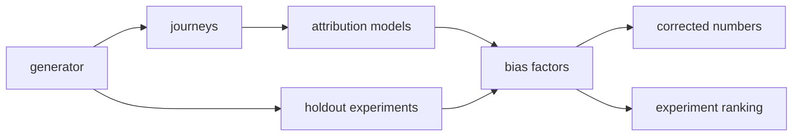

# Architecture

## Context

Attribution models and randomised holdout experiments answer different questions, and organisations tend to report both without reconciling them. Attribution is available daily but measures credit among observed touchpoints; experiments measure incrementality but run rarely. attributiongap uses the experiments to calibrate the daily attribution numbers.

## Container view

Everything is plain Python with no external dependencies. The generator is the only source of data; swapping it for real journey and experiment tables would leave `attribution.py` unchanged.

## Key decisions

- **Known causal structure.** The generator records which channels are truly incremental, so the gap between attributed credit and incrementality can be measured instead of argued about. Trade-off: results show the method works on data with this structure, not on any particular real funnel.
- **Absorbing NULL for removal.** Removing a channel redirects its transitions to NULL. Deleting it from paths would leave conversions untouched and give zero removal effect everywhere.
- **Bias factor with decay.** A factor is a ratio from one experiment at one point in time. Confidence halves every 90 days and the correction shrinks toward the raw number as it falls. Trade-off: the half-life is a fixed parameter.
- **Rank by distance and staleness.** The next experiment goes to the channel where attribution is furthest from truth and the evidence is oldest.

## Failure modes

- Zero incremental conversions makes the factor infinite; `corrected` returns 0 for such a channel and the ranking puts it first.
- Stale evidence (confidence below 0.25) is flagged and shrunk rather than applied at full strength.
- Small holdouts produce noisy factors; the demo is seeded and reproducible, but change the seed and the experiment-based factors move materially.

## Out of scope

- Collecting touchpoints (no tracking pixel or ingestion).
- Replacing experiments.
- Real-data connectors and a SQL/dbt implementation.
